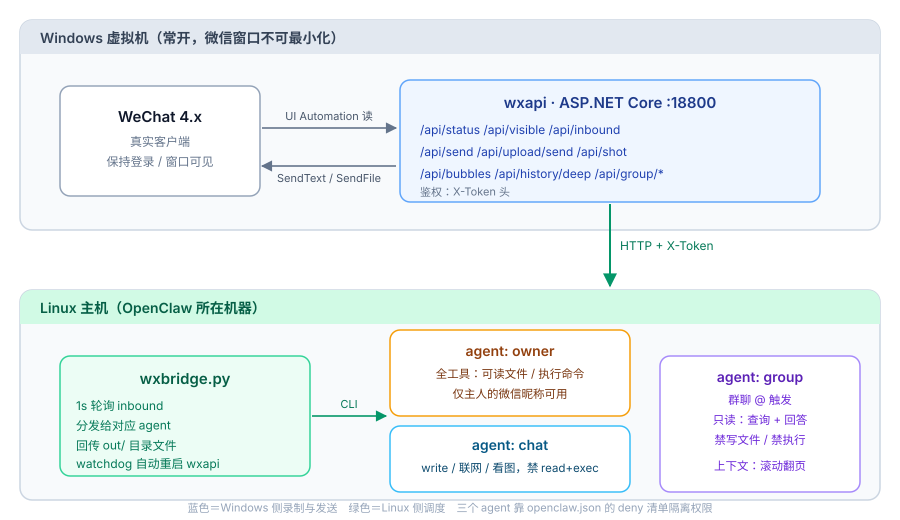

# WeChat ↔ OpenClaw Bridge

**把微信变成 AI Agent 的入口。** 不注入进程、不 hook 客户端、不改协议 —— 纯 UI Automation 驱动真实微信 4.x，双向收发文本与文件。

收消息 → 交给 [OpenClaw](https://www.npmjs.com/package/openclaw) 的 agent 处理 → 回复发回微信。附带三个 agent 的权限分级、文件回传、截屏看图、长上下文翻页，以及一套踩了两个月才总结出来的坑。

> ⚠️ **先说清楚前置条件，免得你 clone 下来编译不过**
>
> 1. **需要一台常开的 Windows**（虚拟机即可），且已登录真实微信 4.x，窗口不能最小化
> 2. **需要 `WeChatAuto4x.SDK`**（NuGet 上的第三方商业组件，**不在本仓库内**，需自行获取授权）
> 3. 需要一台 Linux 跑 OpenClaw（Node 24.16+）
>
> 本仓库提供的是**桥接层与全部踩坑经验**，不是开箱即用的全家桶。看完 `docs/pitfalls.md` 再动手，能省你两周。

```
微信好友/群 → wxapi(Windows VM) → wxbridge(Linux) → OpenClaw agent → 原路发回
```



> **English TL;DR** — A self-hosted bridge that turns a real WeChat 4.x client into an
> AI agent endpoint. No memory injection, no protocol reverse engineering: it drives the
> official client purely through Windows UI Automation. Two components: `wxapi` (ASP.NET
> Core, runs in a Windows VM) and `wxbridge` (Python, runs on the machine hosting your
> OpenClaw agents). Supports text + file both ways, per-agent permission tiers, screenshot
> based image reading, deep history paging, and a watchdog that restarts a wedged service.

---

## 它解决什么问题

大多数人接微信机器人有两条路，都有明显代价：

| 方案 | 代价 |
|---|---|
| hook 客户端 / 内存注入 | 版本一升级就废，且有封号风险 |
| 逆向协议 / web 协议 | 微信 4.x 已无可用 web 协议，第三方协议库普遍不稳定 |

这个项目走第三条：**把微信当成一个普通 Windows 窗口，用 UI Automation 去读、去点**。

- 不碰微信进程内存，不修改任何客户端文件
- 读消息靠 `MessageBubbleList` 的气泡 `ClassName`，发消息靠 SDK 的 `SendText` / `SendFile`
- 代价是：必须有一台 Windows 常开（我用的是 KVM 里的 Win11 虚拟机），且只能读**当前会话窗口**里可见的内容

## 特性

- **双向消息** — 未读轮询收消息（~50ms/次），文本回复、文件回传
- **三档权限** — 主人全权 / 访客零工具 / 群聊只读，靠 `openclaw.json` 的 agent 级 deny 清单隔离
- **文件回传** — agent 把成品写进 `out/` 目录，桥在本轮结束自动发到微信并归档
- **能看图片** — 拿不到加密的 `.dat` 原图，就按气泡坐标截屏再交给 `view_image`
- **长上下文** — 鼠标滚动翻页 + 重叠合并，一个屏 6~8 条能凑到 24 条
- **自愈** — wxapi 卡死（UI 自动化偶发死锁）时，看门狗 SSH 进 VM 强杀重启
- **@ 识别** — 处理了微信 @ 后面那个 U+2005 窄空格，以及「@ 和正文分两条发」

## 架构

```
┌─────────────────────────── Windows VM (192.168.122.100) ───────────────────────────┐
│                                                                                    │
│   WeChat 4.1.x  ◄──── UI Automation ────  wxapi  (ASP.NET Core, :18800)            │
│      ▲                                      │  /api/inbound  /api/send           │
│      │                                      │  /api/upload/send  /api/shot       │
│      └────────── SendText / SendFile ───────┘                                      │
└───────────────────────────────────┬────────────────────────────────────────────────┘
                                    │ HTTP + X-Token
┌───────────────────────────────────▼──────────────── Linux host ────────────────────┐
│                                                                                    │
│   wxbridge.py  ──►  openclaw agent --agent {owner|chat|group} --session-key ...     │
│        │                      │                                                     │
│        │                      ├─ workspace/out        → 主人收到的文件             │
│        │                      ├─ workspace-chat/out   → 访客收到的文件             │
│        │                      └─ workspace-chat/inbox → 截屏落盘，给 view_image     │
│        │                                                                            │
│        └── watchdog: 连续 N 次拉不到 → recover-wxapi.sh → 重启 VM 里的服务          │
└────────────────────────────────────────────────────────────────────────────────────┘
```

## 目录

```
wxapi/            Windows 侧 HTTP 服务（C# / .NET 10）
  Program.cs        所有端点：收发消息、气泡枚举、截屏、文件上传、监听
  wxapi.csproj      依赖 WeChatAuto4x.SDK 2.1.8
  start-api.sample.cmd
bridge/           Linux 侧桥接
  wxbridge.py       轮询 / 分发 / 回传文件 / 看门狗
  wxbridge.service  systemd 单元
  recover-wxapi.sh  卡死时进 VM 重启
prompts/          三个 agent 的人设与硬约束（IDENTITY.md / USER.md）
openclaw.sample.json  权限分级配置样例
probes/           反射探针：摸清 SDK 内部结构的四个小工具
tools/            VM 内运维脚本（强杀重启 / 重新编译）
docs/             架构细节、API 表、踩坑清单
```

## 快速开始

### 0. 前置

- Windows 10/11（虚拟机即可），已登录**真实微信 4.x**
- .NET 10 SDK，`WeChatAuto4x.SDK`（NuGet，第三方商业 SDK，需自备授权）
- 一台常开的 Linux（OpenClaw 装在 Linux 上，Node 24.16+）
- 微信账号在 Windows 上保持登录，窗口**不要最小化到托盘**

### 1. 起 wxapi（Windows）

```bat
git clone <this repo> C:\setup\wxapi-src
cd C:\setup\wxapi-src\wxapi
dotnet build -c Release
set WXAPI_TOKEN=your-long-random-token
dotnet run -c Release
```

验证：

```bash
curl -H "X-Token: your-token" http://<vm-ip>:18800/api/status
# {"ok":true,"online":true,"nick":"...","wxid":"..."}
```

想开机自启，把 `start-api.sample.cmd` 改成你的路径，注册计划任务：

```bat
schtasks /create /tn wxapi /tr "C:\setup\start-api.cmd" /sc onlogon /rl highest /f
```

### 2. 配 OpenClaw 的三个 agent

照 `openclaw.sample.json` 改 `~/.openclaw/openclaw.json`：三个 agent（`owner` 全权、`chat` 零工具、`group` 只读），
再把 `prompts/*` 拷进各自 workspace 当 `IDENTITY.md` / `USER.md`。

**关键：`chat` 的 deny 里必须留 `read`。** 否则访客可以诱导 agent 读你服务器上的任意文件。

```bash
openclaw config validate     # 多 agent 必须显式声明 main / systemAgent
```

### 3. 起 wxbridge（Linux）

```bash
sudo mkdir -p /opt/wxbridge && sudo cp bridge/* /opt/wxbridge/
sudo cp bridge/wxbridge.service /etc/systemd/system/
sudo systemctl daemon-reload && sudo systemctl enable --now wxbridge
journalctl -u wxbridge -f
```

环境变量在 unit 里改：`WXAPI_URL` / `WXAPI_TOKEN` / `WX_OWNER`（主人的微信昵称）。

### 4. 验证

给这个微信号发一条消息，日志应出现：

```
probe <昵称> -> direct
RECV <昵称> -> chat '你好'
SENT <昵称> '你好，有什么可以帮你的'
```

## 权限分级怎么做的

两个独立的门，不要混为一谈：

| 门 | 管什么 | 在哪 |
|---|---|---|
| `dmPolicy` / `allowFrom` | 谁**能进来**说话 | 渠道插件配置 |
| `bindings` + `agents.*.tools.deny` | 进来**能做什么** | `openclaw.json` |

```
peer = 主人          →  agent owner  →  全工具
peer = 任何人（兜底）→  agent chat   →  profile=full + 49 项 deny（read/exec/terminal 全禁）
群聊 @              →  agent group  →  只读，连写文件都禁
```

`chat` 允许 `write / edit / view_image / web_search / web_fetch`，所以它既能联网查资料、又能把结果写成文件发回来 —— 但不能读你的磁盘、不能执行命令。

## 已知限制（诚实版）

- **必须有一台 Windows 常开**，微信窗口不能最小化。这是 UI Automation 的硬约束
- **只能读当前会话**。历史消息要靠滚动翻页，`/api/history` 一次只有 6~8 条
- **图片拿不到原图**。`.dat` 是 V2 加密（文件头 `07 08 56 32 08 07`），密钥在微信进程内存里 —— 那就要注入了，违背设计前提。折中方案是截屏（见 `docs/architecture.md`）
- **UI 自动化偶发死锁**。某个端点卡住会把整个 wxapi 拖死，所以有看门狗 + 冷却 + 短超时三层兜底
- **群消息分不出发言人**。`ChatSimpleMessage` 没有发送者字段，群里只能拿文本
- **第三方 SDK**。`WeChatAuto4x.SDK` 是商业组件，不在本仓库内，需要自行获取授权

## 踩坑清单

`docs/pitfalls.md` 里记了 20 多条，随手摘几条最坑的：

- `ChatContent.MessageBubbleList` 是 **internal 属性**，编译期不可见，必须反射
- `LocateConversation()` **是个假方法**，调完不切会话，读出来的还是上一个会话的气泡
- 用 `curl` 测某些面板永远 404（短 UA 被判定为爬虫），**404 不代表服务挂了**
- 模型声称"看不到图"，八成是配置里 `input: ["text"]`，不是模型不行
- wxapi 重启后 seq 归零，桥的游标停在旧值 → 永远拉不到新消息，**而且日志一条错都不报**
- 靠"未读"判断新消息很脆：任何东西读过那个会话，未读就归零，消息永远丢失。必须用持久化的 `UniqueString` 水位

## 免责声明

本项目仅供个人学习与自用。使用前请确认符合微信软件许可协议与当地法律法规。
不要用于群发营销、骚扰他人或任何违反平台规则的行为。UI 自动化存在账号风险，请自行评估。

## License

MIT
